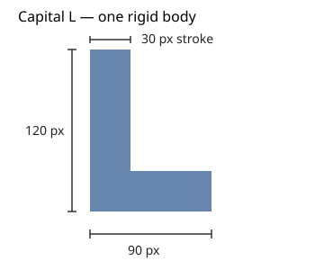
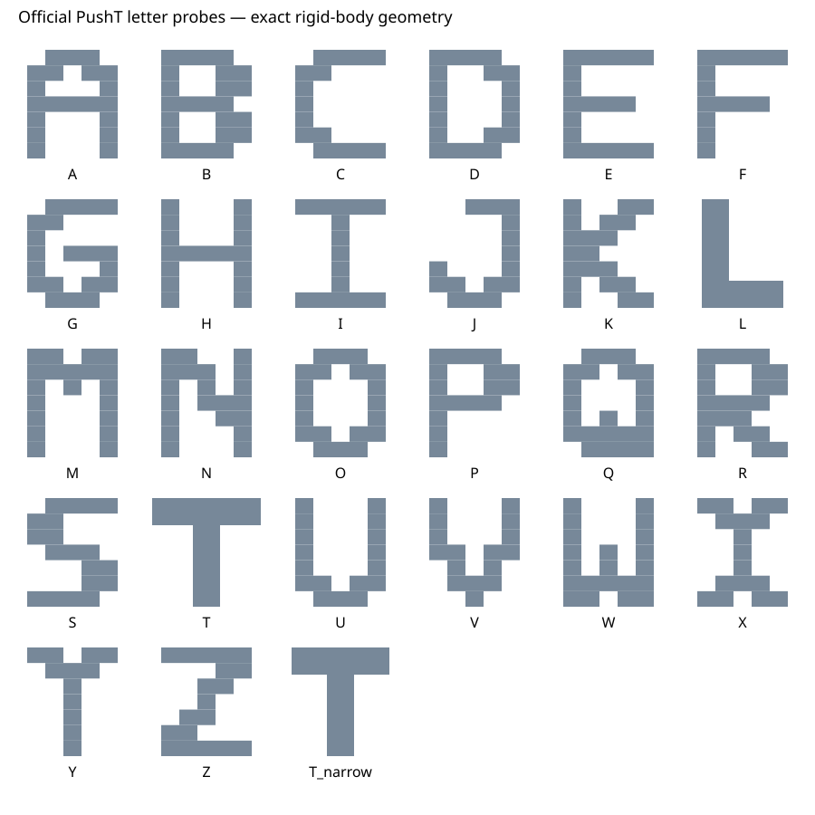

# Official T-to-capital-L setup

The official CNN remains frozen and trained only on T. `tdyssey/envs/official.py`
extends the original PushT simulator through its object-construction hook. T
delegates to the unchanged official construction/controller/reset/render/reward
paths. L is a single rigid body made from two connected, nonoverlapping rectangles.
No simulator, environment, checkpoint, or dataset is downloaded by the commands here.



L is an upright capital letter in its local image coordinates: a **120-pixel-tall
vertical stroke**, **90-pixel total foot width**, and **30-pixel stroke thickness**.
The foot extends to the right at the bottom. Image y increases downward. Rotation
in the task rotates the entire letter; its right angle and proportions stay fixed.

## Geometry and physical choices

| Property | Official T | Capital L |
| --- | --- | --- |
| Area | 6,300 pixel² | 5,400 pixel² |
| Total mass | 1 | 1 |
| Moment of inertia | Original 3,000 | Uniform-density centroid value 1,875 |
| Body center of gravity in local coordinates | Original `(0,45)` | Area centroid `(0,0)` |
| Rotational symmetry | Full turn only | Full turn only |

Before centering, L's stem is `[0,30] × [0,120]` and its foot extension is
`[30,90] × [90,120]`. Subtracting area centroid `(30,75)` gives the stored local
vertices. Both collision polygons attach to the same body and have the same color;
they are not independent bars. Equal total mass does not imply equal density or
inertia. Preserve T's legacy inertia/center convention rather than changing the
trained policy's environment to make these rules uniform.

The source renderer and geometric reward both use actual collision polygons for
the object and target. Tests check their union against the declared vertices and
sample real rendered pixels to verify the bottom/right foot for both object and
goal. The pusher, controller, walls, contact-material convention, image interface,
and official checkpoint preprocessing are unchanged.

The earlier GPC L has different proportions and mass. Its existing data/shape
hashes remain historical reference records; they were not silently rewritten.
Use `official_shape('L')` for current experiments, not `geometry.get_shape('L')`.

## Matched development comparison

```bash
.venv/bin/python -B scripts/evaluate_shapes.py --output artifacts/official-t-l
# CUDA policy plus visible resizable window and small streamed videos:
.venv/bin/python -B scripts/evaluate_shapes.py --output artifacts/official-t-l-visible --display --video --hold-seconds 30
```

Uses the existing [official setup](OFFICIAL_BASELINE.md), CUDA only for policy
inference, and CPU physics. Default budget: one T/L pair, at most 300 controls per
shape, 360 seconds. At most three pairs are allowed. Choose a new output directory.
No policy updates, target-shape play data, action ranking, or world model is used.

Match **mass-center position, angle, full velocities/forces, pusher state, and
target mass center**, keeping each shape's own geometry/inertia. T's body origin
is offset from its center; copying raw coordinates would misalign the objects.
The original T goal stays `(256,256,π/4)`. The corresponding L goal origin is
`(224.18019485,287.81980515,π/4)`, which aligns their target mass centers rather than
their different local origins. Initial and goal poses are fully recorded.

Reject a candidate for both shapes if either object/goal crosses the walls,
pusher clearance is insufficient, or the scene is already close to solved.
Count both reset physics substeps for every candidate, including rejected ones.
Restore the accepted physical state into fresh spaces without extra uncounted
physics steps. This changes the scene distribution relative to unrestricted
official evaluation; it is an explicit matched development protocol, not a paper
benchmark score. The canonical `evaluate_official.py` command is unchanged.

State snapshots include pose, velocities, forces/torque, goal, action target,
control step, and geometry/physics hashes. Restore refuses incompatible shapes or
mass/inertia. Contact-solver caches and future-reset RNG state are not serialized.
Checks establish replay restored before contact; mid-contact restore is pending.

Both shapes start with the same local CUDA noise seed. Use the original two-frame
history, published normalizers/crop, 100 denoising steps, and eight executed actions,
shortening only the last control-budget chunk. Preserve upstream done flags and
report runner cutoff separately. Instantaneous upstream success remains distinct
from the project's provisional five-step sustained-success rule.

## First observation and next task

At common scene seed 100000, T solved the task after 128 controls; L did not solve
within 300. Maximum IoU was 0.9241 for T and 0.3015 for L; L had 288 contact steps
and ended at zero overlap. All T actions and full body-state traces matched the
earlier canonical official run exactly; its video was byte-identical. Reward
differences were at most floating-point roundoff from polygon-area calculation.
See [validation details](VALIDATION.md) for counts and artifact fingerprints.

One scene does not establish a generalization rate or a learning benefit.
[Official non-expert collection](OFFICIAL_COLLECTION.md) is now implemented with
raw observations/actions, full reset provenance, and nonempty frozen whole-episode
train/validation/test splits separate from the known development scenes. The old
GPC fixture datasets are not a matched training set for this new geometry/physics.
Then train/validate the visual world model and verify direct simulator learning
before imagined policy optimization.

## Exploratory capital-letter sweep

The frozen policy can also be tested on **all 26 capitals**, plus `T_narrow`,
without collecting training data. This is an exploratory robustness experiment;
T-to-L adaptation remains the primary research study.



T and L keep the exact definitions above. The other 24 letters use the versioned
5×7 block patterns in `tdyssey/letters.py`: height 120 pixels, width 100 pixels,
20-pixel cell width and `120/7`-pixel cell height. Horizontal occupied runs become
nonoverlapping rectangles on one rigid body. Staircase diagonals connect through
edges, and holes remain empty collision/render/reward regions. This is one
specified block alphabet, not a claim about all fonts or smooth letter outlines.
The unchanged source renderer outlines each collision rectangle, so internal
component seams can also affect the policy image; the SVG shows the filled union.
I uses top and bottom bars. Existing GPC I data is a different geometry.

New letters have mass 1, area-centroid origins and uniform-density inertia.
Shape area/density/inertia and contact contours vary. Therefore differences can
reflect both appearance and dynamics; this sweep does not isolate visual shape
recognition. Half-turn symmetry is recorded for H/I/O/S/X/Z, and overlap scoring
naturally respects those equivalences. The original success threshold is unchanged.

`T_narrow` shortens the T's top bar from **120 to 108 pixels**, leaving its 30-pixel
thickness and 90-pixel stem unchanged. Unlike the other new letters, it preserves
original mass 1, moment of inertia 3000, and the original physical-center convention.
Its local coordinates subtract `(0,45)` to allow center-matched resets. The mass
center is deliberately not replaced by the new area centroid. This is a small,
controlled geometry perturbation rather than another letter or a physically
uniform-density reinterpretation of T. The benchmark T remains unchanged.

```bash
# Small geometry catalog: standard library only; no simulator or GPU needed.
python3 -B scripts/preview_letters.py --output /tmp/official-alphabet.svg
# Two-shape near-T check, with an optional window:
.venv/bin/python -B scripts/evaluate_shapes.py --shapes T T_narrow --output artifacts/official-near-t --display --video
# All capitals plus near-T; save videos without desktop pacing:
.venv/bin/python -B scripts/evaluate_shapes.py --alphabet --seconds 3600 --output artifacts/official-alphabet --video
# Optional peak screenshots from existing videos (installed OpenCV):
.venv/bin/python -B scripts/extract_peak_frames.py --report artifacts/official-alphabet/report.json
# Portable local video gallery and exact CSV, without re-running the model:
python3 -B scripts/summarize_shapes.py --report artifacts/official-alphabet/report.json --output artifacts/official-alphabet/summary.html
```

`--shapes` selects a subset, always including T, without duplicates. `--pairs`
is the number of common scenes (1–3), and `--steps` caps each shape at 300 controls.
`--seconds` is a total wall-time cap (at most 7200), including loading. The default
360-second cap is intended for T/L; provide more time for the alphabet. An early
wall-time stop is reported separately from a completed 300-control failure.
The maximum possible sweep has 24,300 controls, not an unlimited training job.

For every common scene, all selected shapes must pass the same reset checks. If
one fails, reject the candidate for all of them and count every reset substep.
Changing the selected set can therefore change the accepted scene distribution;
use a fixed shape list and saved accepted seeds for later comparisons. All shapes
receive the same per-scene CUDA noise seed, checkpoint and action/control budgets.
The canonical original-T runner remains separate and unchanged.

Inspect best and final IoU, original success, contacts, and the actual videos.
High transient overlap alone can hide an unstable attempt. One development scene
per shape maps examples of failure; it does not establish a generalization limit,
a reliable ranking, or an adaptation benefit. Freeze additional evaluation scenes
before comparing learning methods, and keep these development scenes out of
adaptation data and later final tests.

The first completed sweep used common scene 100000: T and Y succeeded; the other
24 letters and near-T failed within 300 controls. Near-T reached IoU 0.8717 before
ending at 0.7751. These single-scene outcomes do not locate a reliable tolerance
boundary. See [full results and costs](VALIDATION.md).

### Near misses and lost progress

The gallery/CSV records the earliest post-action best-IoU control, coverage at that
moment, final coverage, and **best IoU minus final IoU**. Peak screenshots decode
frame `best_step` from videos that include initial frame zero. Extraction runs no
policy inference or physical replay. These are descriptive diagnostics added after
observing near-aligned objects move away; they do not redefine success or change
termination. Initial-frame overlap is not included in the post-action maximum.

A visually close outline can still miss the original `coverage > 0.95` threshold.
On the development scene, D reached IoU 0.8154 (about 89.8% target coverage) at
control 201, then ended at IoU 0.4172. K reached IoU 0.7512 at control 163, then
ended at 0.0620. These are near misses followed by lost overlap, not cases that
satisfied the original threshold and were ignored. The cause of the later bad
pushes needs further action/observation analysis. Shorter action prefixes, better
fine alignment and a learned stopping decision are possible later experiments;
compare them separately with matched scenes and report any use of privileged
geometric reward for stopping. Selecting the best frame after the run does not
provide an implementable stopping policy or demonstrate stable control.
