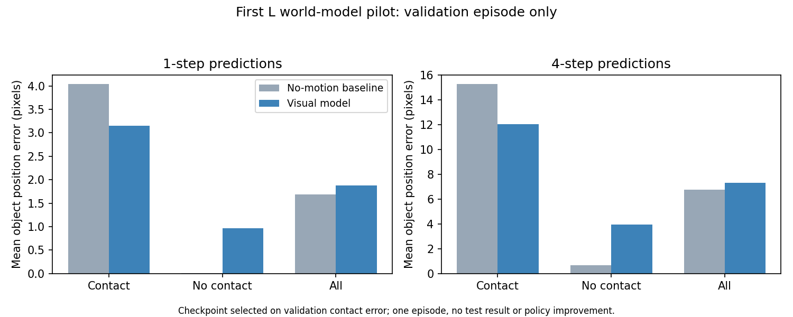
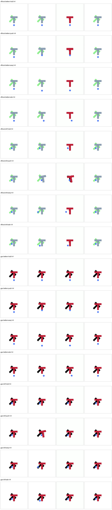
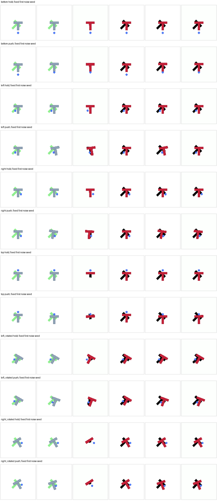

# Published experiment evidence

The selected results below are committed with the source and can be viewed
without installing the project. They include unsuccessful predictions and
limitations. No policy learning or successful T-to-L adaptation is established.
See [current status](STATUS.md), [full evidence and commands](VALIDATION.md) and
[world-model protocols](WORLD_MODEL.md).

## Available in Git

| Experiment | Figures / videos | Machine-readable results |
| --- | --- | --- |
| Frozen official policy, 26 capitals and near-T | [All 27 original MP4s](ALPHABET_RESULTS.md) | [Video provenance](media/official-alphabet-2026-10-19/videos.json) |
| Custom L-only world model | [Prediction preview](media/world-model-2026-10-19/custom-L-predictions.png), [validation errors](media/world-model-2026-10-19/custom-L-validation-errors.png) | [Selected report](media/world-model-2026-10-19/custom-L-summary.json) |
| Frozen pretrained GPC on native/official T | [All prediction branches](media/world-model-2026-10-19/pretrained-T-predictions.png) | [Selected report](media/world-model-2026-10-19/pretrained-T-summary.json) |
| Matched T palette experiment | [Original/palette comparison](media/world-model-2026-10-19/palette-T-comparison.png) | [Selected report, including failed first-run accounting](media/world-model-2026-10-19/palette-T-summary.json) |

The four PNGs, three JSON summaries and their [manifest](media/world-model-2026-10-19/manifest.json)
total **775,943 bytes (0.74 MiB)**. Images preserve the original bytes. Summaries
copy selected fields from actual reports, omit raw state histories and host
details, and record the original report size/hash. They do not replace full raw
reports. The published 27-video snapshot separately uses about 11.5 MiB.

## What the figures show

Custom L model: contact improvement, worse overall motion errors

The checkpoint was selected using contact error on one validation episode.
Noncontact and overall errors worsened against persistence. This is one training
seed and is not a final test result or policy improvement.

The [prediction preview](media/world-model-2026-10-19/custom-L-predictions.png)
shows input / actual / predicted / persistence images at horizons one through four.
Images and auxiliary motion predictions can disagree.

Pretrained GPC: appearance mismatch and a missed side rotation

Columns: initial image / physical future / model future / persistence. Each row
names its simulator family, approach and action candidate. Official gray/green
inputs become red and lose the target; native left-push rotation is largely missed.
Two hand-constructed scenes do not estimate overall model performance.

Matched palette experiment: most predictions improve, left push still fails

Columns: original current / original physical future / original-input prediction /
palette current / palette physical future / palette-input prediction.
The figure uses the fixed first noise seed for every scene; all three noise
repeats are included in the JSON summary.

On official physics, contact centroid proxy error improved from 10.901 to 3.272
pixels and visible-target recall from 0.033 to 0.954. The left-push prediction is
worse in the palette view. Known-color masks are image proxies, not verified
physical pose estimates. Auxiliary palette rendering uses simulator access and
is not an image-only deployed adapter. Six development scenes and three inference
noise repeats do not establish generalization or policy learning.

## What remains outside Git

| Artifact | Current location / access |
| --- | --- |
| Full raw reports, source-frame archives and collected episodes | Ignored `artifacts/` on the producing machine |
| Downloaded and trained checkpoints | Ignored `checkpoints/` or experiment output directories |
| Environments, upstream checkouts and caches | Local ignored paths; reconstruct using shared setup instructions |
| Additional raw videos and future runs | Local/ignored until a small result selection is published |

**No shared raw-data/checkpoint archive is configured yet.** A coauthor cannot
recover these local files from their hashes. The commands in [VALIDATION.md](VALIDATION.md)
and [WORLD_MODEL.md](WORLD_MODEL.md) support reproduction; exact original raw files
need a separate transfer or future shared archive. Raw artifacts have not been
deleted. Keep weights, datasets and caches out of routine Git history.

For future published snapshots, preserve successes and failures, add clear figure
captions and source hashes, and keep the selection small. The current world-model
snapshot has a 1 MiB cap checked by `scripts/check_repo.py`.
