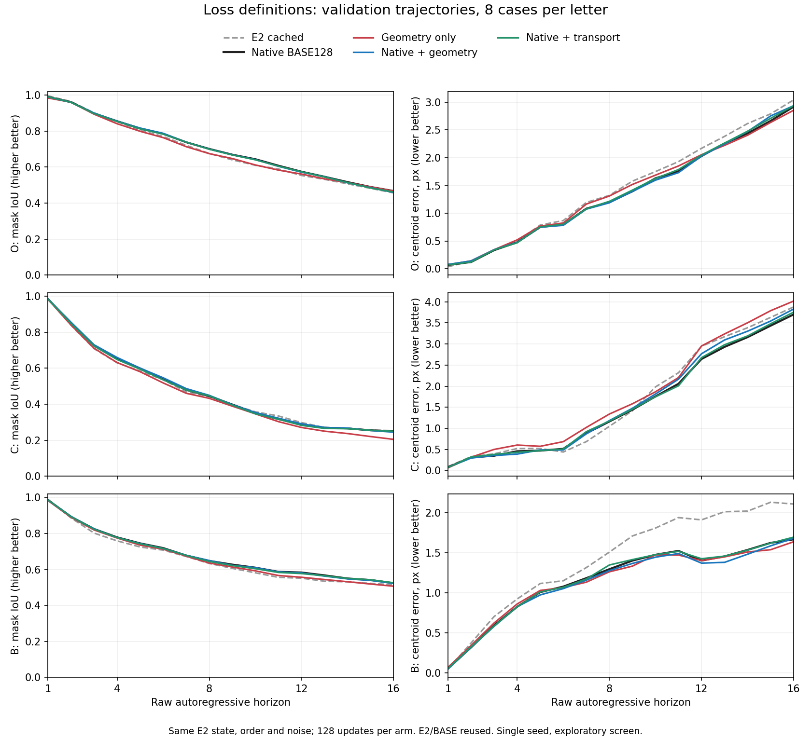

# Tdyssey Letter World Model

Visual, action-conditioned prediction of a circular pusher interacting with rigid letter shapes. This repository assembles the available local implementations, controlled comparisons, diagnostics and negative results through **2 November 2026**.

**Status:** curated research source archive, maintained as `world-model/` inside Tdyssey. Run the commands below from this directory. The local [prediction app](apps/r3b-playground/README.md) now defaults to the owner-selected HMF500 checkpoint for H1/AR4 use, using external assets. Long-horizon geometry, rotation and contact prediction remain unreliable; no tested loss replacement has passed the complete O/C/B acceptance conditions. This is a research archive, not a validated physical world model.

[中文导读](README.zh-CN.md) · [Experiment archive](experiments/README.md) · [Results](docs/RESULTS.md) · [Reproduction](docs/REPRODUCIBILITY.md) · [Review checklist](REVIEW_CHECKLIST.md)

## Scope

The native GPC predictor consumes four 96×96 RGB history frames and aligned continuous XY actions, then predicts the next RGB frame. Recursive evaluation feeds predictions into later histories, including 16-step sequences. The broader Tdyssey project investigates cross-shape pushing and policy adaptation; direct-simulator policy work is preserved as a separate historical profile.

This collection includes the official PushT/Diffusion Policy baseline, GPC interfaces, custom visual models, native denoising adaptation, data/contact/controller studies, generated-history training, high-motion fitting, multi-step losses, noise/detail/frequency losses, and occupancy/transport definitions. Repeated validation is disclosed; seen letters are not described as unseen-shape generalization.

## Repository layout

| Path | Purpose |
| --- | --- |
| `tdyssey/` | Current first-party simulator interfaces, data, models, training and measurement code |
| `scripts/`, `configs/`, `examples/` | Explicit command-line stages, versioned settings and examples |
| `tests/` | Existing focused tests; runtime tests require their assets/environment |
| `apps/` | Local interactive prediction/inspection application sources |
| `experiments/` | Twelve research categories, with per-run source/evidence indices |
| `archive/workspaces/` | Distinct older source and environment profiles; no blind cross-branch merging |
| `manifests/` | Source provenance, deduplication, upstream pins and external asset metadata |
| `tools/` | Source reconstruction, explicit upstream retrieval and release validation |

## Quick start: inspect without installing anything

Python 3.12 is the recorded project version. The release checker requires Python 3.11+ and only the standard library.

```bash
python -B scripts/check_repo.py
python -B tools/materialize_sources.py --help
python -B scripts/native_rgb_world_model.py --help
```

These commands do not train, collect data or load checkpoints. For a full dependency installation, pinned upstream sources, explicit asset verification and the appropriate historical profile, follow [installation](docs/INSTALLATION.md). The archived experiments require private datasets and trained parent checkpoints; source availability alone is not an end-to-end reproduction claim.

## Main experiment families

| Family | Controlled question | Recorded outcome / limit |
| --- | --- | --- |
| Native RGB / staged training | Does original GPC H1 residual MSE fit our observations? | Staged pilots and failures retained; no universal fit claim |
| Physics / contact / sampling | Are interaction data and controller protocols consistent? | Finite-force and original kinematic protocols are explicitly separate |
| A/B/C/D history and region losses | Can generated history and foreground/detail emphasis reduce drift? | Some aggregate gains; no complete shape/rotation pass |
| High-motion fit | Does stronger motion exposure improve fitting? | 3,000 updates; validation C and old failure cases still regress |
| Four-step rollout loss | Does an AR4 objective help recursive prediction? | Original preflight failure and repaired run both retained; report-stage failure disclosed |
| Min-SNR / GDL / FFL | Do noise weighting, image gradients or frequency errors help? | Mixed short-screen effects; no complete directional support |
| Dice / spatial transport | Can object occupancy or movement distance define error better? | Three 128-update arms; no replacement passes all O/C/B conditions |



The figure summarizes saved validation predictions, not newly run experiments. See [results and limitations](docs/RESULTS.md) for the common baseline, controls, failed gates and single-seed budget.

## Assets and attribution

Raw datasets, full optimizer/model checkpoints, frame archives, caches, personal environments and local execution/callback records are excluded. Original/public source hashes and an explicit external-evidence index preserve provenance. Some retired assets no longer exist locally; those attempts are labelled rather than reconstructed from memory.

External repositories are pinned in [upstream.json](manifests/upstream.json): Diffusion Policy, GPC, DPPO and DIWA. GPC is a separate reference model, not the official policy baseline. Read [third-party notices](THIRD_PARTY_NOTICES.md) and [license status](LICENSE.md) before redistribution. No open-source license has been assigned to project-owned code during this organization step.
